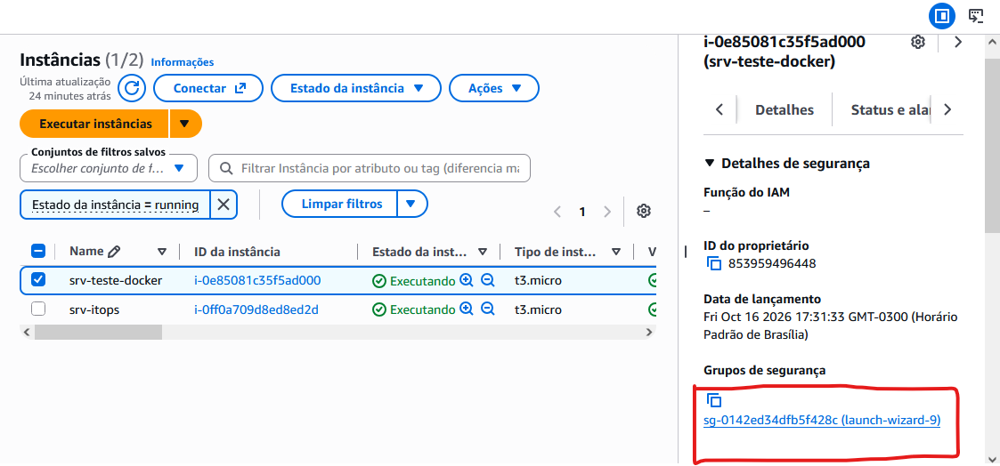
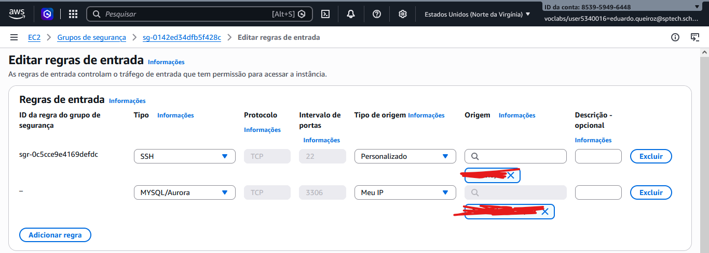

# Tutorial: configurar o grupo de segurança da AWS para acessar o MySQL do Docker

Este guia explica como permitir que o script Python consulte o banco MySQL que está em um container Docker executando em uma instância EC2. O objetivo é liberar **somente o acesso MySQL necessário**, sem expor o banco para toda a internet.

## Antes de começar

Confirme estes pontos:

- [ ] A instância EC2 que hospeda o banco está **em execução**.
- [ ] O Docker está instalado e iniciado, e o container do MySQL está **em execução**.
- [ ] O container publica a porta do MySQL para a instância, normalmente `3306` (por exemplo, `3306:3306`).
- [ ] O arquivo `.env` do script Python contém os dados corretos de conexão.
- [ ] Você tem permissão para visualizar e editar o grupo de segurança associado à instância.

> **Importante:** o grupo de segurança controla o tráfego até a instância EC2. Ele não substitui a configuração de portas do Docker, as permissões do usuário MySQL nem as regras de firewall do sistema operacional.

## 1. Abrir a instância EC2

1. Entre no [Console da AWS](https://console.aws.amazon.com/).
2. Abra o serviço **EC2**.
3. No menu lateral, selecione **Instâncias**.
4. Localize a instância que hospeda o banco de dados e confirme que o estado está como **Em execução (`running`)**.
5. Selecione a instância.

A instância que aparece no seu `.env` como servidor do banco precisa ser a instância correta — não necessariamente a mesma máquina em que o script Python será executado.



## 2. Abrir o grupo de segurança

Com a instância selecionada:

1. Abra a aba **Segurança** no painel de detalhes.
2. Na seção **Grupos de segurança**, clique no grupo associado à instância.
3. Na página do grupo, abra a aba **Regras de entrada**.
4. Clique em **Editar regras de entrada**.

Se a instância tiver mais de um grupo de segurança associado, verifique qual deles será editado. As regras de entrada aplicáveis são combinadas entre os grupos associados.

## 3. Adicionar a regra de entrada para MySQL

Na tela **Editar regras de entrada**, clique em **Adicionar regra** e preencha assim:

| Campo | Valor |
|---|---|
| Tipo | `MySQL/Aurora` |
| Protocolo | `TCP` (preenchido automaticamente) |
| Intervalo de portas | `3306` (preenchido automaticamente) |
| Tipo de origem | `Meu IP` para acesso a partir do computador atual, ou uma origem restrita apropriada para o ambiente |
| Descrição (opcional) | `Acesso MySQL para script Python` |

Exemplo visual da tela de regras de entrada:



### Escolha a origem correta

- **Script executado no seu computador:** selecione `Meu IP`. A AWS preencherá o endereço público atual com uma máscara `/32`, permitindo somente aquele IP. Se seu IP público mudar, será necessário atualizar a regra.
- **Script executado em outra instância EC2:** prefira permitir a origem pelo **grupo de segurança da instância cliente**, quando a arquitetura e a rede permitirem, em vez de liberar um IP amplo.
- **Script executado em uma rede corporativa:** peça ao responsável pela rede o IP público de saída ou a faixa aprovada e restrinja a regra a essa origem.

**Não use `0.0.0.0/0` para a porta 3306.** Isso permite tentativas de conexão a partir de qualquer endereço IPv4 da internet e expõe o serviço a riscos desnecessários. A regra SSH da imagem é independente da regra MySQL; não é necessário alterá-la para configurar o banco.

Depois de preencher os campos, clique em **Salvar regras**.

## 4. Conferir o arquivo `.env`

No projeto Python, confirme que as variáveis correspondem ao endereço público ou privado correto da instância, à porta publicada e ao usuário de banco criado para o script. Os nomes das variáveis dependem da implementação; um exemplo genérico seria:

```dotenv
DB_HOST=ENDERECO_DA_INSTANCIA
DB_DATABASE=NOME_DO_BANCO
DB_USER=USUARIO_DO_BANCO
DB_PASSWORD=SENHA_DO_BANCO
```

Use os nomes esperados pelo seu código. **Não compartilhe o `.env` nem coloque senhas, chaves ou endereços sensíveis em repositórios públicos.** Se o script roda em uma EC2 na mesma VPC, normalmente é preferível usar o endereço privado da instância do banco e restringir a origem ao grupo de segurança cliente.

## 5. Verificações se a conexão falhar

Confira na seguinte ordem:

1. A instância EC2 está em execução?
2. O Docker está iniciado e o container do MySQL está em execução?
3. O container publica a porta `3306` para o host?
4. A regra de entrada TCP `3306` permite a origem correta?
5. O `.env` aponta para o host, porta, banco, usuário e senha corretos?
6. O usuário MySQL tem permissão para conectar a partir da origem do script?
7. Se o acesso for entre instâncias, elas têm conectividade de rede (VPC, sub-redes, rotas e ACLs) adequada?

Se a regra estiver correta, mas a conexão continuar falhando, o problema pode estar no Docker, no MySQL ou na rede — não necessariamente no grupo de segurança.

## Checklist final

- [ ] Instância EC2 do banco em execução.
- [ ] Docker e container MySQL em execução.
- [ ] Porta `3306` publicada pelo container.
- [ ] Regra de entrada TCP `3306` criada com **origem restrita**.
- [ ] `.env` configurado com os dados corretos.
- [ ] Usuário MySQL autorizado para a conexão.

Com essas configurações, o script poderá tentar consultar o banco para verificar se o endereço MAC está cadastrado, desde que as permissões do MySQL e a configuração de rede também estejam corretas.
